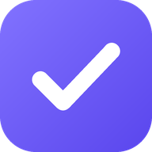
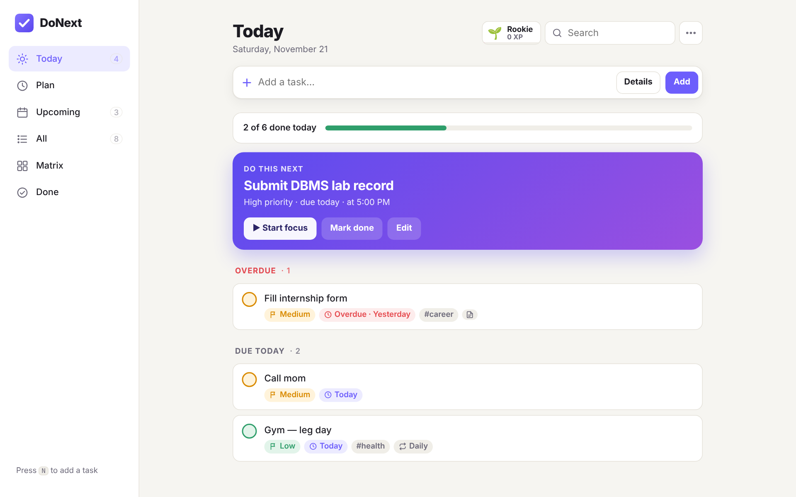
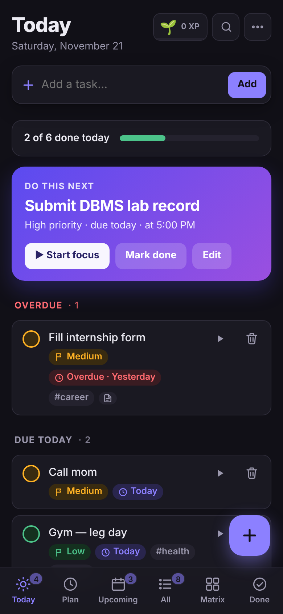
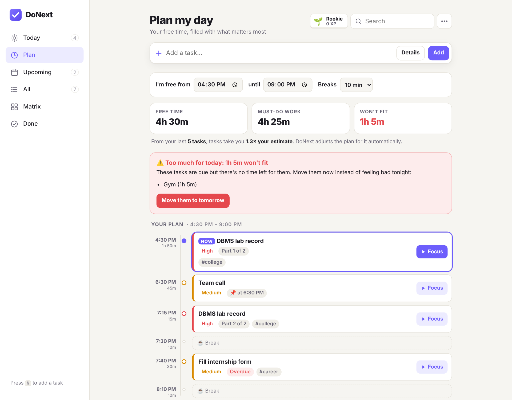
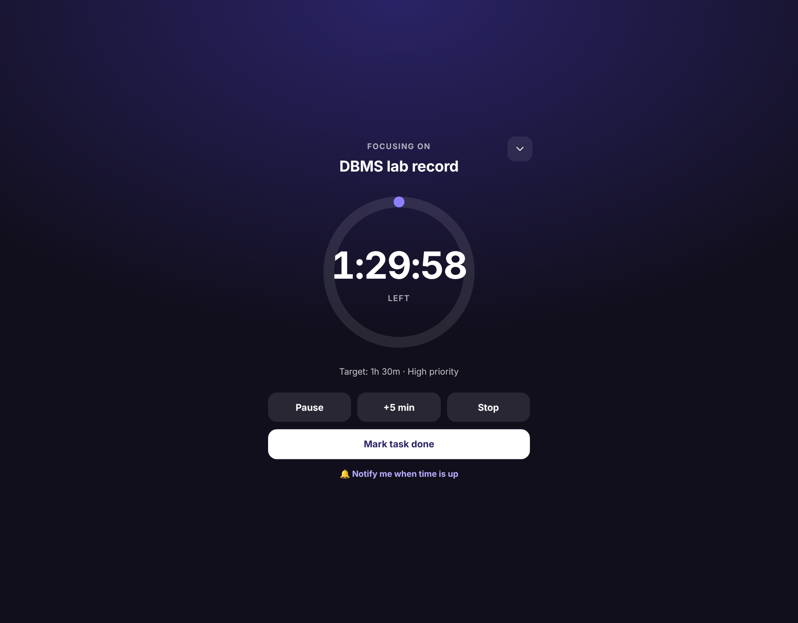
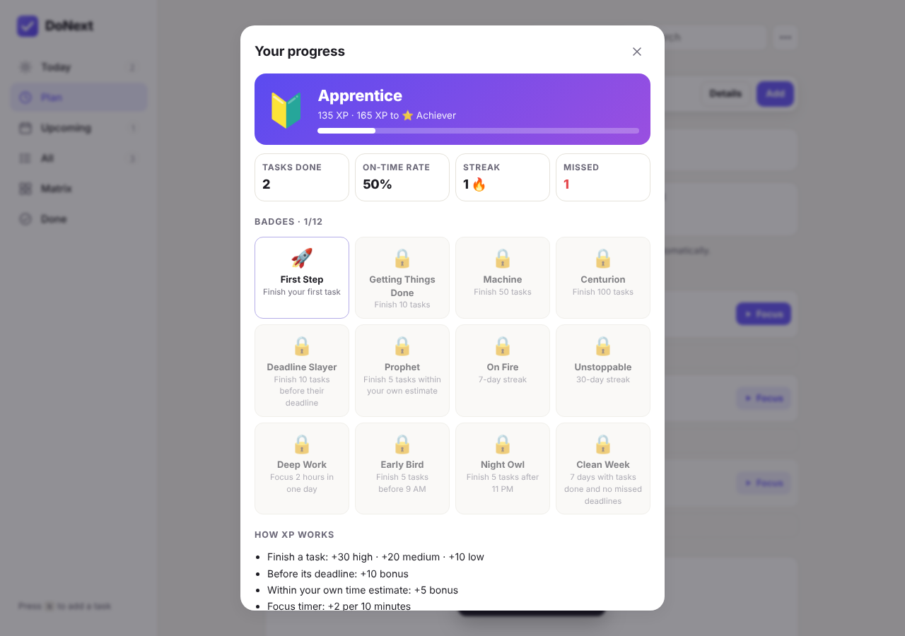
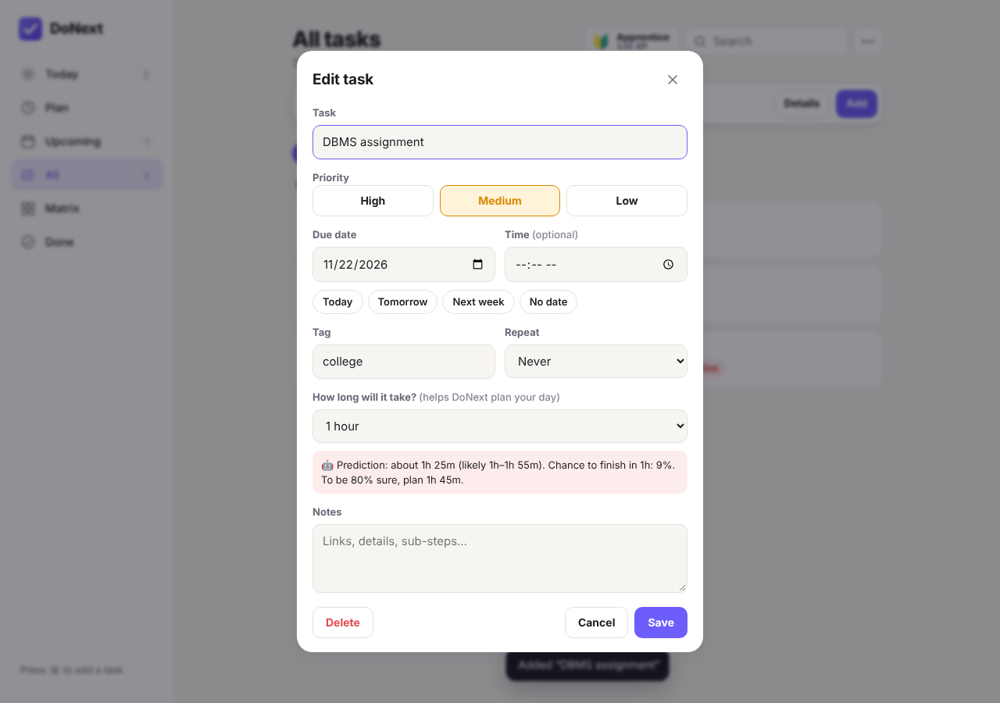

<div align="center">



# DoNext

**A priority-first to-do app that tells you what to do next.**
Works on phone, tablet and laptop, installs like a normal app, and runs fully offline.

**[▶ Open the app](https://tomatoo0-90.github.io/donext/)**

</div>

<p align="center">
  
  &nbsp;
  
</p>

---

## Features

- **"Do this next" card**: DoNext ranks every open task by priority and due date and shows the one to do now, with a **▶ Start focus** button.
- **🎮 XP, ranks and badges**: earn XP for finishing tasks, lose it for missed deadlines, and climb from Rookie to God of Productivity.
- **🤖 On-device AI**: predicts how long each task will really take you, and the % chance you'll finish in the time you chose.
- **Plan my day**: builds a timeline of your free time, learns how long your tasks really take, and warns you when you've planned too much.
- **Today view**: overdue items, today's tasks and a progress bar for the day.
- **Upcoming view**: future tasks grouped by day, plus a "No date" list.
- **Priority matrix**: an Eisenhower view (Do first / Schedule / Quick wins / Later).
- **Quick add shortcuts**: type `Submit report !h #college @tomorrow` and the priority, tag and date are filled in for you.
- **Repeating tasks**: daily, weekly or monthly. When you tick one off, the next one is created.
- **Tags, search and notes** on any task.
- **Undo** for completing, deleting and clearing tasks.
- **Light and dark mode**: follows your system setting, or you can pick one.
- **Works offline and installs** on Android, iPhone/iPad, Windows, macOS, Linux and ChromeOS.
- **Private**: no account and no server. Your tasks never leave your device.
- **Backup and restore** to a `.json` file, which is also how you move tasks between devices.

## What makes DoNext different 🧠

Most to-do apps just store a list. DoNext **plans your day for you and learns how long your tasks really take.**

<p align="center">
  
  &nbsp;
  
</p>

### 1. Plan my day
Tell DoNext when you're free, for example *"I'm free from 6 PM until 11 PM"*. It builds a **timeline** for that window:
- Tasks with a set time are pinned to that time 📌
- Overdue and due-today tasks are fitted in first, most important first
- Any time left over is used to **get ahead** on upcoming tasks
- Short breaks go between tasks if you want them

### 2. Reality check
If you have more due work than free time, DoNext tells you, e.g. *"⚠️ 1h 40m won't fit"*. It lists the tasks that won't fit and gives you a **"Move them to tomorrow"** button.

### 3. It learns how long things take *you*
Give a task a time estimate (`~45m` in quick add, or "How long will it take?" in the editor) and press **▶ Focus** to start a timer. When you finish, DoNext compares your estimate with the real time. After 3 tasks it knows your personal **speed factor**, e.g. *"tasks take you 1.4× your estimate"*, and builds future plans with that extra time.

### 4. Focus timer
A full-screen timer with a progress ring. It uses your estimate, or a 25-minute Pomodoro if you didn't set one. It also:
- Keeps the screen on while it runs
- Plays a chime when time is up
- Keeps running in a mini bar if you minimise it
- Survives closing the app

### 5. Insights
A chart of your focus time for the last 7 days, plus:
- Tasks completed and your 🔥 streak
- The hour you focus best
- How accurate your estimates are
- Which tag got most of your time

All of it runs **offline on your device**: no account, no server, no AI key.

Backups (**⋯ → Export backup**) include your XP, badges and the AI's training data, so moving to a new phone keeps your rank.

## 🎮 Level up: XP, ranks and badges

Getting things done earns **XP**, and missing deadlines costs XP:

| Action | XP |
|---|---|
| Finish a task | **+30** high · **+20** medium · **+10** low |
| Finish it before its deadline | **+10** bonus |
| Finish within your own time estimate | **+5** bonus |
| Focus timer | **+2** per 10 minutes |
| Unlock a badge | **+25** |
| **Miss a deadline** | **−15** (yes, you can get demoted) |

**Ranks:** 🌱 Rookie → 🔰 Apprentice → ⭐ Achiever → 💪 Pro → 🎯 Expert → 💎 Elite → 🥋 **Master** → 👑 Grandmaster → 🐉 Legend → ⚡ **God of Productivity** (10,000 XP)

**12 badges** to unlock, such as 🗡️ Deadline Slayer, 🔮 Prophet (5 tasks within your estimate), 🔥 On Fire (7-day streak), 🧘 Deep Work (2 hours of focus in a day) and 🛡️ Clean Week.

Tap your rank in the top bar to see your progress, badges and XP history. Undoing a task takes its XP back, so there's no cheating 😉

<p align="center"></p>

## 🤖 How the AI works

DoNext includes a small **machine-learning model that runs entirely on your device**. It learns how long tasks *really* take **you**, and predicts whether you can finish a task in the time you chose.

<p align="center"></p>

**Training data:** every finished task that had an estimate gives one example, with its real time measured by the focus timer or a one-tap "how long did it take?" question:

```
estimate, actual time, priority, tag, hour of day, weekday
```

**Model:** Bayesian ridge regression on the log of the *overrun ratio*:

```
y = ln(actual / estimate)          ≈  w · x   +  noise ~ N(0, σ²)

x = [ bias, ln(estimate/30), high priority, low priority,
      afternoon, evening, night, weekend, #tag₁ … #tag₆ ]
```

- Weights are solved in closed form, `w = (XᵀX + λI)⁻¹ (Xᵀy + λ·w₀)`, using Gaussian elimination written from scratch in plain JS.
- The prior `w₀` says *"people need ~25% more time than they guess"* (the planning fallacy). That means the model gives sensible answers from day one and becomes personal as data comes in.
- `σ` is the residual spread, blended with a prior.

**Predictions** for a task with estimate *E*:

```
expected time       = E · e^μ                      (μ = w · x)
80% range           = E · e^(μ ± 1.28σ)
P(done within T)    = Φ( (ln(T/E) − μ) / σ )       (Φ = normal CDF)
time to be 80% sure = E · e^(μ + 0.84σ)
```

**Where you see it:**
- 🤖 chips on tasks, e.g. *"~52m · 18% within 30m"*, or *"35% to make the deadline"* when a deadline is close
- A live prediction while you pick an estimate, e.g. *"To be 80% sure, plan 50m"*
- **Plan my day** uses the predicted durations, not your raw guesses
- **AI insights** on the Plan page:
  - **Accuracy**, measured with leave-one-out cross-validation: *"within ±12m, vs ±21m for your own guesses (43% more accurate)"*
  - **Patterns** it found, e.g. *"#college tasks take you 57% longer"*, *"Evening tasks take you 23% longer"*

When tested on made-up data with known patterns, the model found them (#college ×1.8 → learned ×1.57, evening ×1.3 → learned ×1.23). Its average error on tasks it hadn't seen was **±14 min**, compared with **±42 min** for the guesses.

## Install it on your device

Open **https://tomatoo0-90.github.io/donext/**, then:

| Device | How to install |
|---|---|
| **Android** (Chrome) | Tap **⋮** → **Add to Home screen** / **Install app** |
| **iPhone / iPad** (Safari) | Tap **Share** → **Add to Home Screen** |
| **Windows / Mac / Linux** (Chrome or Edge) | Click the **install icon** in the address bar, or **⋯** menu → **Install DoNext** |

After that it opens in its own window like any other app and works without internet.

## How the prioritising works

Each open task gets a score:

```
score = priority weight × 2 + urgency

priority weight:  High = 3, Medium = 2, Low = 1
urgency:          overdue = 5, today = 4, tomorrow = 3, within 3 days = 2, within a week = 1, later or no date = 0
```

The task with the highest score goes in the "Do this next" card, and every list is sorted the same way. As a result, a **High** task due today (score 10) comes before a **Medium** task that's a day overdue (9), and that comes before a **Low** task due today (6).

The **matrix** counts High and Medium as *important*, and anything overdue or due by tomorrow as *urgent*.

## Quick-add shortcuts

| Type | Meaning |
|---|---|
| `!h` `!m` `!l` | High / Medium / Low priority (default is Medium) |
| `#college` | Tag |
| `@today` `@tomorrow` `@mon` … `@sun` `@week` | Due date |
| `~30m` `~1h` `~1.5h` | How long it will take (used by Plan my day) |

Keyboard: **N** adds a task, **/** searches, **Esc** closes a dialog, **Space** pauses the focus timer.

## Using it on more than one device

Tasks are saved **in the browser on each device** (localStorage), so there's no sign-up and nothing is uploaded. To copy your tasks to another device, use **⋯ → Export backup** on the first device and **⋯ → Import backup** on the other. Imports are merged, so nothing gets overwritten by accident.

## Run it locally

You don't need to install or build anything, because it's plain HTML, CSS and JavaScript.

```bash
git clone https://github.com/Tomatoo0-90/donext.git
cd donext
python -m http.server 8000
```

Then open http://localhost:8000. You can also double-click `index.html`, but offline mode and installing only work when the app is served over `http(s)`.

## Project structure

```
donext/
├── index.html            # Page layout and the add/edit dialog
├── styles.css            # All styling, responsive layout, light/dark themes
├── app.js                # App logic: storage, prioritising, views, quick-add parser
├── ai.js                 # On-device ML model: predicts real task duration + chance to finish in time
├── planner.js            # Plan my day, focus timer, insights
├── game.js               # XP, ranks, badges, deadline penalties
├── sw.js                 # Service worker for offline support
├── manifest.webmanifest  # Makes it installable (name, icons, colours)
├── icons/                # App icons
└── screenshots/          # Images used in this README
```

## Tech

Vanilla JavaScript (no frameworks, no build step), CSS custom properties for theming, `localStorage` for data, Web Audio, the Screen Wake Lock API, the Notifications API, and a Service Worker plus Web App Manifest to make it a **Progressive Web App (PWA)**. It's hosted for free on **GitHub Pages**.

## Roadmap

- [x] Plan my day, focus timer, learned time estimates, insights
- [x] XP, ranks and badges
- [x] On-device ML: duration prediction + on-time probability
- [ ] Reminders/notifications for timed tasks
- [ ] Android app (APK)
- [ ] Sub-tasks / checklists inside a task
- [ ] Drag to reorder
- [ ] Optional cloud sync between devices

## Author

**Anish Verma** · [@Tomatoo0-90](https://github.com/Tomatoo0-90)
B.Tech Data Science, Rungta University

## License

[MIT](LICENSE): free to use, change and share.
